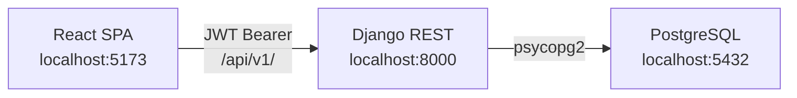

# DevForum

> **Reference Only — All Rights Reserved**
>
> This repository is publicly available for portfolio presentation and technical evaluation only. Public visibility does not grant permission to deploy, operate, commercially use, modify, redistribute, or create derivative works from this software. Any additional use requires prior written authorization under the applicable license and subject to applicable law. All rights not expressly granted are reserved.
>
> See [LICENSE](LICENSE). To request permission for additional use, contact majeed.developer0@gmail.com.

A full-stack developer community Q&A platform built with Django REST Framework and React TypeScript.

> **Portfolio project** — Professional-grade implementation demonstrating full-stack engineering with a real backend API, complete frontend, automated tests, and comprehensive documentation.

---

## Screenshots

> *Screenshots will be added after the application is run locally for the first time. See [Setup](#prerequisites) below to start both applications.*

| Page | Description |
|------|-------------|
| `[Home Page]` | Landing page with recent questions and popular tags |
| `[Question Feed]` | Searchable, filterable question list with pagination |
| `[Question Detail]` | Full question with answers, voting, and comments |
| `[Ask Question]` | Markdown editor with tag selection |
| `[User Profile]` | Public profile with activity stats |

---

## Features

- **Questions & Answers** — Post technical questions and detailed answers with Markdown support and syntax highlighting
- **Voting** — Upvote/downvote questions and answers; duplicate votes are prevented and vote changes are handled atomically
- **Accepted Answers** — Question authors mark one answer as accepted; acceptance is enforced at the database level
- **Tags** — Assign and filter by tags; tags are normalized and slugified automatically
- **Comments** — Short clarification comments on questions and answers
- **Notifications** — In-app notifications for answers, comments, and accepted answers
- **Profiles** — Public profiles with real activity statistics and reputation
- **Authentication** — JWT-based auth with automatic token refresh and secure logout
- **Search & Filters** — Full-text search across title, body, and tags; filter by status, tag, and sort order
- **Responsive Design** — Works at desktop, tablet, and mobile widths

---

## Technology Stack

### Backend

| Technology | Version | Purpose |
|-----------|---------|---------|
| Python | 3.12 | Runtime |
| Django | 5.1.4 | Web framework |
| Django REST Framework | 3.15.2 | API layer |
| djangorestframework-simplejwt | 5.3.1 | JWT authentication |
| PostgreSQL | 16 | Database |
| drf-spectacular | 0.28.0 | OpenAPI documentation |
| django-cors-headers | 4.6.0 | CORS |
| django-filter | 24.3 | Filtering |
| psycopg2-binary | 2.9.10 | PostgreSQL driver |
| pytest + pytest-django | — | Testing |
| Ruff | 0.8.2 | Linting + formatting |

### Frontend

| Technology | Version | Purpose |
|-----------|---------|---------|
| React | 19 | UI framework |
| TypeScript | 7 | Type safety |
| Vite | 8 | Build tool |
| TanStack Query | 5 | Server state management |
| React Router | 7 | Client routing |
| React Hook Form + Zod | 7 + 4 | Form validation |
| Tailwind CSS | 4 | Styling |
| Axios | 1 | HTTP client |
| react-markdown | 10 | Markdown rendering |
| Vitest + RTL | — | Testing |

---

## Architecture Overview



See [docs/ARCHITECTURE.md](docs/ARCHITECTURE.md) for a detailed breakdown with component diagrams and design decisions.

---

## Repository Structure

```
DevForum/
├── backend/                  # Django project
│   ├── apps/
│   │   ├── accounts/         # User model, auth, profiles
│   │   ├── questions/        # Questions, answers, comments
│   │   ├── tags/             # Tag model
│   │   ├── votes/            # Voting system
│   │   └── notifications/    # In-app notifications
│   ├── config/               # Django settings, root URLs
│   ├── venv/                 # Python virtual environment (not committed)
│   ├── requirements.txt
│   ├── pytest.ini
│   ├── ruff.toml
│   ├── mypy.ini
│   └── seed_data.py          # Development seed data
├── frontend/                 # React application
│   ├── src/
│   │   ├── components/       # Reusable UI components
│   │   ├── contexts/         # React contexts (AuthContext)
│   │   ├── lib/              # API client, utilities
│   │   ├── pages/            # Route-level page components
│   │   ├── test/             # Test setup and test files
│   │   └── types/            # TypeScript type definitions
│   ├── package.json
│   └── vite.config.ts
├── docs/                     # Technical documentation
├── .github/
│   └── workflows/ci.yml      # GitHub Actions CI
├── docker-compose.yml        # PostgreSQL service (development)
├── .env.example
├── README.md
├── CONTRIBUTING.md
├── CHANGELOG.md
└── LICENSE
```

---

## Prerequisites

- **Python 3.12+** — [python.org](https://www.python.org/downloads/)
- **Node.js 20+** — [nodejs.org](https://nodejs.org/)
- **PostgreSQL 16** — [postgresql.org](https://www.postgresql.org/download/) or Docker

---

## Local Setup

### 1. Clone the Repository

```bash
git clone <repository-url>
cd DevForum
```

### 2. Configure Environment Variables

```bash
cp .env.example backend/.env
```

Edit `backend/.env` with your local database credentials. The `VITE_API_BASE_URL` line at the bottom is for the frontend and belongs in `frontend/.env.local` (already created with defaults).

### 3. Set Up PostgreSQL

**With Docker:**
```bash
docker-compose up -d postgres
```

**Without Docker (manual):**
```sql
-- In psql as superuser:
CREATE USER devforum_user WITH PASSWORD 'devforum_password';
CREATE DATABASE devforum OWNER devforum_user;
GRANT ALL PRIVILEGES ON DATABASE devforum TO devforum_user;
```

### 4. Backend Setup

```bash
cd backend

# Create and activate virtual environment
python -m venv venv
.\venv\Scripts\activate       # Windows
source venv/bin/activate       # macOS/Linux

# Install dependencies
pip install -r requirements.txt

# Apply migrations
python manage.py migrate

# Create superuser (optional)
python manage.py createsuperuser

# Load development seed data
python seed_data.py

# Start the development server
python manage.py runserver
```

Backend runs at **http://localhost:8000**

### 5. Frontend Setup

```bash
cd frontend

# Install dependencies
npm install --legacy-peer-deps

# Start the development server
npm run dev
```

Frontend runs at **http://localhost:5173**

---

## Environment Variables

All variables are documented in `.env.example`. Required variables:

| Variable | Default | Description |
|----------|---------|-------------|
| `SECRET_KEY` | insecure dev key | Django secret key |
| `DEBUG` | `True` | Django debug mode |
| `DB_NAME` | `devforum` | PostgreSQL database name |
| `DB_USER` | `devforum_user` | PostgreSQL username |
| `DB_PASSWORD` | `devforum_password` | PostgreSQL password |
| `DB_HOST` | `localhost` | PostgreSQL host |
| `DB_PORT` | `5432` | PostgreSQL port |
| `CORS_ALLOWED_ORIGINS` | `http://localhost:5173` | Allowed frontend origins |
| `VITE_API_BASE_URL` | `http://localhost:8000/api/v1` | Frontend API base URL |

---

## Authentication

DevForum uses JWT (JSON Web Tokens):

- **Access token**: 60-minute lifetime, passed as `Authorization: Bearer <token>`
- **Refresh token**: 7-day lifetime, used to obtain new access tokens
- **Token rotation**: Each refresh rotates both tokens; old refresh tokens are blacklisted
- **Logout**: Blacklists the refresh token on the backend

See [docs/SECURITY.md](docs/SECURITY.md) for the full permission matrix.

---

## API Documentation

Interactive API docs (Swagger UI): `http://localhost:8000/api/docs/`

See [docs/API.md](docs/API.md) for endpoint documentation with request/response examples.

---

## Development Commands

### Backend

```bash
# In backend/ with venv active

python manage.py runserver         # Start development server
python manage.py migrate           # Apply migrations
python manage.py makemigrations    # Create new migrations
python manage.py createsuperuser   # Create admin user
python manage.py check             # Django system checks
python seed_data.py                # Load seed data

# Testing
python -m pytest                   # Run all tests
python -m pytest -v --tb=short    # Verbose output

# Linting
python -m ruff check apps/ config/ --select E,F --ignore E501
python -m ruff check apps/ config/ --select I --fix   # Fix imports

# Type checking
python -m mypy apps/
```

### Frontend

```bash
# In frontend/

npm run dev          # Start development server (http://localhost:5173)
npm run build        # Production build (outputs to dist/)
npm run preview      # Preview production build
npm run type-check   # TypeScript type check (no emit)
npm test             # Run tests with Vitest
npm run test:watch   # Run tests in watch mode
npm run lint         # ESLint
npm run format       # Prettier format
```

---

## Database

See [docs/DATABASE.md](docs/DATABASE.md) for the full schema and ER diagram.

**Tables:** User, Tag, Question, Answer, Comment, Vote, Notification

**Migrations:** `python manage.py migrate`  
**Seed data:** `python seed_data.py`

Seed data creates:
- 4 users: `alice_dev`, `bob_coder`, `carol_writes`, `dave_builds` (password: `DevForum123!`)
- Admin: `admin@devforum.dev` / `Admin123!`
- 10 tags: python, javascript, react, django, typescript, postgresql, docker, rest-api, git, css
- 4 realistic sample questions with 2 accepted answers

---

## Testing

```bash
# Backend tests (requires PostgreSQL)
cd backend
python -m pytest

# Frontend tests
cd frontend
npm test
```

See [docs/TESTING.md](docs/TESTING.md) for the full test strategy.

### Test Results (local verification — 2026-10-29)

| Suite | Status | Notes |
|-------|--------|-------|
| Django system check | ✅ Passed | `0 issues identified` |
| Ruff linting | ✅ Clean | Auto-fixed import sort; 0 remaining errors |
| Backend tests | ⏳ Requires PostgreSQL | Tests written; not run — no local PostgreSQL in this environment |
| Frontend type-check | ✅ Passed | `tsc --noEmit` — no errors |
| Frontend build | ✅ Passed | 3037 modules, 929 kB JS / 286 kB gzipped |
| Frontend tests | ✅ 16/16 passed | 3 test files, all passing |

---

## Security

See [docs/SECURITY.md](docs/SECURITY.md) for the full security documentation.

Key points:
- Passwords hashed with PBKDF2-SHA256
- JWT tokens never returned with password hashes
- Server-side permission checks on all write operations
- Vote uniqueness enforced by database constraints
- Markdown rendered safely on the client (no arbitrary HTML)

> This project has not been penetration tested. Do not use in production without a security review.

---

## Deployment

> **Reference only:** the guidance below documents how the system is designed to run. Deploying or operating this software requires prior written authorization under the [LICENSE](LICENSE).

See [docs/DEPLOYMENT.md](docs/DEPLOYMENT.md) for production setup with nginx and gunicorn.

The project has not been deployed to production. It is designed for portfolio review.

---

## Troubleshooting

See [docs/TROUBLESHOOTING.md](docs/TROUBLESHOOTING.md) for solutions to common issues including:
- PostgreSQL setup without Docker
- CORS configuration
- JWT token issues
- Migration errors
- Frontend build issues

---

## Known Limitations

1. **No email verification** — Registration does not verify email addresses
2. **No password reset** — Users can change password only when logged in
3. **No real-time** — Notifications are not pushed in real time (polling-based)
4. **Local media storage** — Avatar uploads stored on disk; production needs object storage (S3, etc.)
5. **No E2E tests** — Playwright setup documented but not implemented
6. **No Docker production setup** — Only a dev Docker Compose for PostgreSQL
7. **Backend tests require PostgreSQL** — Cannot run with SQLite due to partial indexes

---

## Roadmap

- [ ] Email verification on registration
- [ ] Password reset via email
- [ ] Playwright end-to-end tests
- [ ] WebSocket notifications
- [ ] Question bookmarks
- [ ] User reputation badges
- [ ] Moderation queue
- [ ] Dark mode

---

## Documentation Index

| Document | Description |
|----------|-------------|
| [docs/ARCHITECTURE.md](docs/ARCHITECTURE.md) | System design, component breakdown, data flow |
| [docs/DATABASE.md](docs/DATABASE.md) | Schema, ER diagram, constraints, indexes |
| [docs/API.md](docs/API.md) | All endpoints with examples |
| [docs/SECURITY.md](docs/SECURITY.md) | Auth, permissions, threat model |
| [docs/TESTING.md](docs/TESTING.md) | Test strategy and commands |
| [docs/DEPLOYMENT.md](docs/DEPLOYMENT.md) | Production setup guide |
| [docs/TROUBLESHOOTING.md](docs/TROUBLESHOOTING.md) | Common errors and fixes |
| [docs/IMPLEMENTATION_PLAN.md](docs/IMPLEMENTATION_PLAN.md) | Build phases and status |
| [CONTRIBUTING.md](CONTRIBUTING.md) | Development guidelines |
| [CHANGELOG.md](CHANGELOG.md) | Project history |

---

## License

Copyright (c) 2026 Abdul Majeed. All rights reserved.

This project is published under a custom **Reference-Only Source-Available License**. It is **not** an open-source license. See [LICENSE](LICENSE). Deployment, commercial use, modification and redistribution require prior written authorization. Permission requests: majeed.developer0@gmail.com


## Contributing

This project is published for reference and portfolio evaluation and is not open to outside contributions or pull requests. See [LICENSE](LICENSE) for the use that is permitted, and contact me to request any additional permission.

