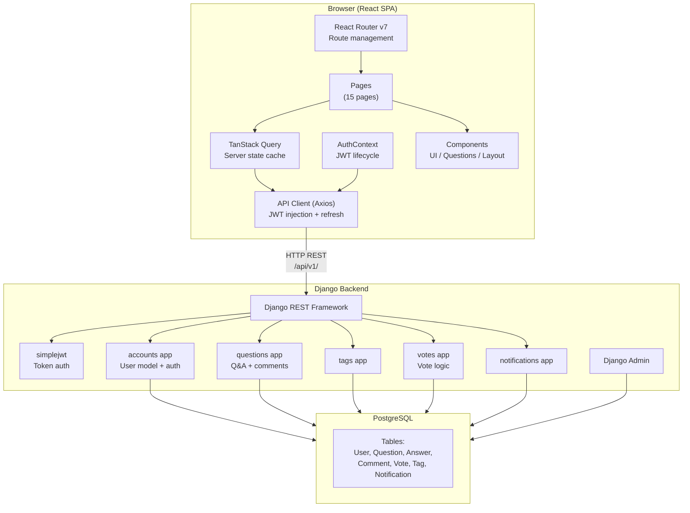

# DevForum — Architecture

## Overview

DevForum is a full-stack web application with a Django REST API backend and a React TypeScript SPA frontend. The two applications are deployed separately and communicate over HTTP.

```
┌─────────────────────────────────────────────────┐
│                  Browser (SPA)                   │
│   React 19 + TypeScript + Vite + TanStack Query  │
│          http://localhost:5173 (dev)             │
└──────────────────────┬──────────────────────────┘
                       │  HTTP/JSON  (JWT Bearer)
                       │  /api/v1/...
┌──────────────────────▼──────────────────────────┐
│              Django REST Framework               │
│          http://localhost:8000 (dev)             │
│                                                  │
│  config/       ← project settings, root URLs     │
│  apps/                                           │
│    accounts/   ← users, auth, profiles           │
│    questions/  ← questions, answers, comments    │
│    tags/       ← tags                            │
│    votes/      ← voting system                   │
│    notifications/ ← in-app notifications         │
└──────────────────────┬──────────────────────────┘
                       │  psycopg2
┌──────────────────────▼──────────────────────────┐
│              PostgreSQL 16                       │
│          localhost:5432 (dev)                    │
└─────────────────────────────────────────────────┘
```

## Architecture Diagram



## Backend Architecture

### Application Boundaries

| App | Responsibility | External Dependencies |
|-----|---------------|----------------------|
| `accounts` | Custom user model, registration, login, profile | `simplejwt` |
| `questions` | Questions, answers, comments | `accounts`, `tags`, `votes`, `notifications` |
| `tags` | Tag model, discovery | — |
| `votes` | Vote model and service | `questions` |
| `notifications` | Notification model and service | `questions`, `accounts` |

### Authentication Strategy

JWT tokens via `djangorestframework-simplejwt`:
- Stateless access tokens (60 min)
- Rotating refresh tokens with blacklist (7 days)
- Standard `Authorization: Bearer <token>` header

This was chosen over session/cookie auth because it fits the SPA architecture naturally (no CSRF concerns, easy mobile-app extension in future).

### API Layer

All endpoints are versioned under `/api/v1/`. This allows future breaking changes to be introduced under `/api/v2/` without disrupting clients.

### Business Logic Placement

- **Simple CRUD**: In DRF generic views (`ListCreateAPIView`, `RetrieveUpdateDestroyAPIView`)
- **Multi-step logic** (accept answer, cast vote): In dedicated `APIView` subclasses or service functions
- **Vote logic**: In `votes/services.py` — extracted because it involves multiple database operations in a transaction
- **Notification creation**: In `notifications/services.py` — called from question/answer creation views

### N+1 Prevention

All list views use:
```python
Question.objects.select_related('author').prefetch_related('tags').annotate(answer_count=Count('answers'))
```

Detail views additionally prefetch nested relations:
```python
.prefetch_related('answers__author', 'answers__comments__author', 'answers__votes', 'comments__author', 'votes')
```

## Frontend Architecture

### Module Structure

```
src/
├── App.tsx              # Router, providers
├── main.tsx             # Entry point, QueryClient
├── contexts/
│   └── AuthContext.tsx  # Auth state + JWT management
├── lib/
│   ├── api.ts           # Axios instance + interceptors
│   ├── api-helpers.ts   # Typed API functions per domain
│   └── utils.ts         # cn(), timeAgo(), getErrorMessage()
├── types/
│   └── index.ts         # All TypeScript types matching API shapes
├── components/
│   ├── auth/            # ProtectedRoute
│   ├── layout/          # Navbar, Layout
│   ├── questions/       # QuestionCard, QuestionForm, VoteControls, etc.
│   └── ui/              # Button, Input, Badge, etc.
└── pages/               # One file per route (15 pages)
```

### State Management

- **Server state**: TanStack Query v5 — all API data, caching, invalidation
- **Auth state**: React Context (AuthContext) — user object, login/logout actions
- **Form state**: React Hook Form + Zod — form data, validation
- **No Redux or global state store**: Not needed for this application's complexity

### Data Flow: Question Feed

```
QuestionsPage
  → useQuery(['questions', params], () => questionsApi.list(params))
  → TanStack Query cache (5 min stale time)
  → apiClient.get('/api/v1/questions/?...')
  → [interceptor adds Authorization header]
  → Django QuestionListCreateView
  → QuestionFilter + search + ordering applied
  → Paginated JSON response
  → QuestionListSerializer (per item: author, tags, answer_count annotated)
  → Rendered as list of QuestionCard components
```

### Authentication Flow

```
Login form submit
  → authApi.login({ email, password })
  → POST /auth/login/ → { access, refresh, user }
  → localStorage.setItem('access_token', access)
  → localStorage.setItem('refresh_token', refresh)
  → AuthContext.setUser(user)
  → Redirect to /

On 401:
  → interceptor calls /auth/token/refresh/
  → New tokens stored
  → Original request retried
  → On refresh failure: tokens cleared, redirect to /login
```

## Key Design Decisions

### Custom User Model

Created at the start of the project (before any migrations) as required by Django's recommendation. Uses email as the `USERNAME_FIELD`, keeping usernames as display identifiers.

### Vote Score Denormalization

`vote_score` is stored directly on `Question` and `Answer` models rather than aggregating from the `Vote` table at query time. This avoids expensive `SUM()` subqueries on hot read paths. Vote changes update the score atomically via `queryset.update()`.

### Notification Service

Notifications are created synchronously (not via Celery/queues) since this avoids the complexity of a task queue for a portfolio-scale application. For high-traffic production use, moving to async notifications with a queue would be appropriate.

### Tag Normalization

Tags are lowercased and slugified on save. Tags created by name during question creation use `get_or_create` on the slug. This prevents duplicate tags like "Python" vs "python".

### React Router v7

React Router v7 was used (latest stable). It uses the same `Routes`/`Route`/`useNavigate`/`useParams` API as v6, so existing knowledge applies.
