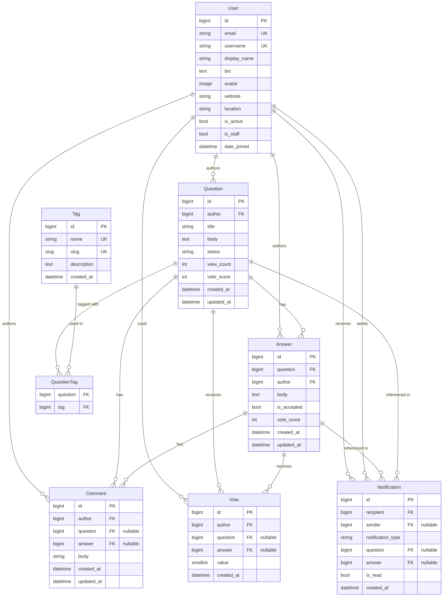

# DevForum — Database Design

## Overview

DevForum uses PostgreSQL 16 via Django's ORM. All models use BigAutoField primary keys and UTC timestamps.

## Entity Relationship Diagram

## Models

### User (accounts.User)

Custom user model extending `AbstractBaseUser` and `PermissionsMixin`.

| Column | Type | Constraints |
|--------|------|-------------|
| id | bigint | PK, auto |
| email | varchar(254) | UNIQUE, NOT NULL |
| username | varchar(50) | UNIQUE, NOT NULL |
| display_name | varchar(100) | |
| bio | text | max 500 chars |
| avatar | varchar (path) | nullable |
| website | varchar(200) | |
| location | varchar(100) | |
| is_active | bool | default True |
| is_staff | bool | default False |
| date_joined | timestamptz | auto |

**Indexes:** `username`, `email`

**Notes:**
- `USERNAME_FIELD = 'email'` — login uses email
- `REQUIRED_FIELDS = ['username']`
- `reputation` is a computed property (not stored), derived from votes and accepted answers

---

### Tag (tags.Tag)

| Column | Type | Constraints |
|--------|------|-------------|
| id | bigint | PK |
| name | varchar(50) | UNIQUE |
| slug | slug(60) | UNIQUE, auto-generated |
| description | text | |
| created_at | timestamptz | auto |

**Indexes:** `slug`

---

### Question (questions.Question)

| Column | Type | Constraints |
|--------|------|-------------|
| id | bigint | PK |
| author_id | bigint | FK → User, CASCADE |
| title | varchar(300) | NOT NULL, min 15 chars |
| body | text | NOT NULL, min 30 chars |
| status | varchar(10) | `open`/`solved`/`closed` |
| view_count | int | default 0 |
| vote_score | int | default 0 |
| created_at | timestamptz | auto |
| updated_at | timestamptz | auto |

**Indexes:** `(-created_at)`, `(-vote_score)`, `status`, `author_id`

**Tags:** ManyToMany through `questions_question_tags` junction table

**Business rules:**
- Soft deletion: set `status = 'closed'` rather than deleting questions with answers
- Only the author or admin can edit/delete

---

### Answer (questions.Answer)

| Column | Type | Constraints |
|--------|------|-------------|
| id | bigint | PK |
| question_id | bigint | FK → Question, CASCADE |
| author_id | bigint | FK → User, CASCADE |
| body | text | min 30 chars |
| is_accepted | bool | default False |
| vote_score | int | default 0 |
| created_at | timestamptz | auto |
| updated_at | timestamptz | auto |

**Indexes:** `(question_id, -is_accepted, -vote_score)`, `author_id`

**Business rules:**
- At most one accepted answer per question (enforced at the application layer via atomic transaction)
- Only the question's author can accept/unaccept an answer
- An answer can only be accepted for the question it belongs to

---

### Comment (questions.Comment)

| Column | Type | Constraints |
|--------|------|-------------|
| id | bigint | PK |
| author_id | bigint | FK → User, CASCADE |
| question_id | bigint | FK → Question, CASCADE, nullable |
| answer_id | bigint | FK → Answer, CASCADE, nullable |
| body | varchar(600) | min 10 chars |
| created_at | timestamptz | auto |
| updated_at | timestamptz | auto |

**Constraints:** `comment_has_exactly_one_target` — exactly one of `question_id` or `answer_id` must be non-null (database-level CHECK constraint)

**Indexes:** `question_id`, `answer_id`

---

### Vote (votes.Vote)

| Column | Type | Constraints |
|--------|------|-------------|
| id | bigint | PK |
| author_id | bigint | FK → User, CASCADE |
| question_id | bigint | FK → Question, CASCADE, nullable |
| answer_id | bigint | FK → Answer, CASCADE, nullable |
| value | smallint | +1 or -1 |
| created_at | timestamptz | auto |

**Constraints:**
- `unique_question_vote` — UNIQUE(author, question) WHERE question IS NOT NULL
- `unique_answer_vote` — UNIQUE(author, answer) WHERE answer IS NOT NULL
- `vote_has_exactly_one_target` — exactly one of question/answer is non-null
- `vote_value_valid` — value IN (1, -1)

**Indexes:** `(question_id, author_id)`, `(answer_id, author_id)`

**Business rules:**
- Users cannot vote on their own content (enforced at application layer)
- Toggling same vote removes it; opposite vote changes score by 2

---

### Notification (notifications.Notification)

| Column | Type | Constraints |
|--------|------|-------------|
| id | bigint | PK |
| recipient_id | bigint | FK → User, CASCADE |
| sender_id | bigint | FK → User, SET NULL, nullable |
| notification_type | varchar(20) | `answer`/`comment`/`vote`/`accepted` |
| question_id | bigint | FK → Question, CASCADE, nullable |
| answer_id | bigint | FK → Answer, SET NULL, nullable |
| is_read | bool | default False |
| created_at | timestamptz | auto |

**Indexes:** `(recipient_id, -created_at)`, `(recipient_id, is_read)`

## Migration Strategy

- Migrations are stored in `apps/<app>/migrations/`
- Run `python manage.py migrate` to apply all migrations
- Never edit existing migration files; create new ones for schema changes
- For production, always test migrations on a backup database first

## Seed Data

Run `python seed_data.py` from the `backend/` directory with the virtual environment active to populate development data:
- 4 regular users (password: `DevForum123!`)
- 1 admin user (admin@devforum.dev / `Admin123!`)
- 10 tags (python, javascript, react, django, typescript, postgresql, docker, rest-api, git, css)
- 4 sample questions with realistic content
- 2 accepted answers

## Performance Considerations

- `select_related('author')` on all list endpoints that need user data
- `prefetch_related('tags')` on question list to avoid N+1
- Annotating `answer_count` via `Count('answers')` on list view
- `vote_score` is denormalized (stored on the model, updated atomically) to avoid expensive aggregations on hot paths
- View count is updated with `update()` (skips model save signals) to minimize overhead
